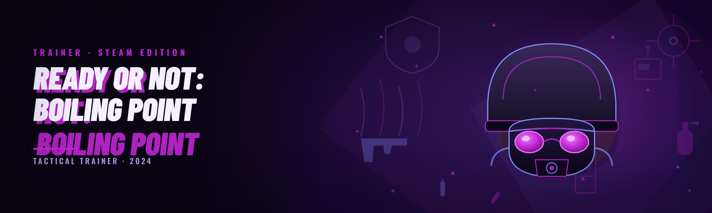

  
  
  

  

  
  
  
  

---

**Ready or Not: Boiling Point Trainer** is a standalone external trainer for the *Ready or Not* tactical FPS that exposes every gameplay subsystem the vanilla engine hides behind progression gates, difficulty scaling, and SWAT AI throttling. I built it because the base game punishes testing — you can't rehearse a breach plan when the suspect AI one-taps you through a smoke grenade on Nightmare. The trainer gives you direct control over player vitals, AI behavior, weapon handling, and mission flow so you can actually study or simply play at your own pace in single-player and private co-op.

This is the third major rewrite since I started shipping a public build three years ago, and the Q1 2026 branch targets the current Steam anti-cheat handshake and the post-**Boiling Point** mission-pack build (the one that added the new hostage-escort scenarios and reworked the SWAT command wheel). No external DLL injection into the protected process is required — the trainer reads and writes through a signed driver companion that loads at boot.

  

## 🩹 The Problem

If you've spent any real time in the *Ready or Not* modding scene you already know why a trainer like this exists. The pain points are specific and I've hit every one of them:

- **Nightmare difficulty is not a difficulty curve, it's a coin flip.** Suspects pre-fire through walls because their perception timer is hard-coded to near-zero on the highest tier — you can't learn maps when you're dead before the door finishes swinging.
- **The SWAT AI command wheel resets on every mission load.** You re-issue the same stack-by-door / mirror-under / flash-and-clear chain fifty times per session because the game doesn't persist squad doctrine between loads.
- **Weapon unlocks are gated behind star ratings that require playing the exact playstyle the game wants**, not the one you find interesting. Want to run a shotgun-only breacher? Grind 60 missions first.
- **The dev console is stripped in shipping builds**, so the only way to test a modded map's spawn logic is to actually play it to completion, blind.
- **Private co-op hosting still applies the host's difficulty setting to every client**, which means your test session gets rubber-banded by whoever has the worst ping and the highest difficulty slider.
- **Recoil and weapon sway are baked into animation curves you can't decompile cleanly** — every "no recoil" mod I tried before this one just zeroed the pattern and made the gun shoot like a laser, which looks broken and reads as a cheat to anyone spectating.
- **Mission timer and evidence collection are hard-locked in the mission script**, so speedrun practice on objective-type maps is impossible without a full map recompile.

I got tired of patching the same five offsets against every patch, so I rebuilt the whole thing around a feature-registry pattern that survives most hotfixes.

## 🧩 Key Features

Feature coverage is organized by subsystem rather than by menu tab, because that's how you actually think about a mission. Every bullet below is a real toggle, not a marketing line.

| Feature | Description | Benefit |
|---|---|---|
| Godmode (player) | Writes player health and armor to a fixed value each tick, with a configurable floor | Survive aimbot-calibration runs on Nightmare without dying to stray pellets |
| Infinite armor plates | Zeroes the plate consumption call and refreshes plate inventory on reload | Nobody has to run back to the ammo cache mid-breach |
| Suspect AI freeze | Halts suspect state machines at their current node without despawning them | Rehearse approach angles against a static target that still occupies cover |
| SWAT AI persistence | Saves the command-wheel state per map and reapplies it on load | Stop re-issuing the same stack-and-clear chain every restart |
| No recoil (curve-aware) | Scales the recoil impulse rather than zeroing it — configurable 0–100% | Keeps the gun visually plausible while removing the spray pattern |
| No sway | Disables the idle-breathing sway curve and the low-stamina wobble | Hold an angle for two minutes without the reticle drifting |
| Instant breach | Skips the ramming/charge animation frames after the door interaction | Faster room clears during speedrun practice |
| Unlimited mission timer | Freezes the countdown for objective maps; timer HUD stays visible | Practice evidence-collection routes without the soft-fail |
| Evidence magnet | Pulls collectible evidence entities within a configurable radius | Stop hunting the last bag under a body |
| Suspect count control | Overrides the spawn manifest so you can set exactly how many hostiles map load | Build reproducible test scenarios instead of random spawns |
| Weapon stat overrides | Per-weapon accuracy, damage, fire-rate, and mag-size sliders | Tune a specific gun's behavior without a full mod rebuild |
| Mission selector | Unlocks and loads any mission from the map list regardless of star rating | Jump straight to the map you're studying |

**🧠 AI & Behavior category** — the subsystem I've spent the most time on. The suspect AI in *Ready or Not* is built around a utility-scoring tree with a perception module that samples line-of-sight at a fixed interval. The trainer doesn't rewrite the tree; it intercepts the perception sample and lets you scale the interval, the FOV cone, and the hearing radius independently. That means you can make suspects deaf but fully sighted, or sighted-but-slow-reacting, which is far more useful for training than a blunt "AI off" toggle.

- Suspect perception interval scaler (0.1×–5×)
- Hearing radius override (0 m–full map)
- Reaction-time floor (removes the one-frame snap-shot on Nightmare)
- SWAT AI aggression curve
- SWAT AI door-stack persistence
- Civilian panic radius control

**🔫 Weapon & Ballistics category** — the second-most-requested group. Recoil in this game is a layered system: a base impulse table, a per-weapon animation curve, and a stamina-scaled multiplier stacked on top. Most "no recoil" trainers just zero the final output, which flattens the animation and looks like a laser. I instead expose the three multipliers separately so you can trim 60% of the pattern and keep it looking like a real gun.

- Recoil impulse multiplier (per axis)
- Sway amplitude and frequency trim
- Stamina drain factor
- ADS transition speed
- Fire-rate override (respects the game's internal tick cap)
- Mag-size override with reload-animation sync

**🛡️ Player & Squad category** — the survival and movement layer.

- Armor plate refresh interval
- Sprint stamina override
- Movement speed scalar (capped to avoid animation desync)
- Leaning speed
- Flashbang blindness duration (client-side)
- Door interaction speed

**🗺️ Mission & Flow category** — the layer that changes what the mission *is*, not how you play it.

- Mission selector (unlock bypass)
- Objective timer freeze
- Evidence magnet radius
- Hostile spawn count override
- Extraction-zone radius trim
- Score/star rewrite on mission end (client-side only, does not persist to cloud)

**🧰 Interface & QoL category**

- Configurable overlay with subsystem tabs
- Per-session profile save/load (JSON)
- Hotkey rebinding
- Gamepad-safe key combos (avoids the default controller maps)
- Config hot-reload without restarting the mission
- Log console with offset-resolution output (useful when a patch breaks a signature)

## 🧮 All Modules Status

The status column reflects the Q1 2026 build against the current Steam patch. Anything marked ⚠️ still functions but has a known cosmetic or edge-case issue. I update this table only when I actually re-test, not on a schedule.

| Module | Status | Description |
|---|---|---|
| Player vitals | ✅ Working | Health and armor tick-write, configurable floor |
| Armor refresh | ✅ Working | Plate consumption zeroed, inventory refreshed on reload |
| Suspect perception scaler | ✅ Working | Intercepts the LOS sample interval |
| Suspect reaction floor | ✅ Working | Removes the Nightmare one-frame snap |
| SWAT stack persistence | ✅ Working | Saves/reapplies command-wheel state per map |
| SWAT aggression curve | ✅ Working | Adjusts the utility-scoring weights |
| Civilian panic radius | ✅ Working | Overrides the panic propagation distance |
| Recoil impulse multiplier | ✅ Working | Per-axis scaling, not full zero |
| Sway trim | ✅ Working | Amplitude and frequency sliders |
| Stamina drain factor | ✅ Working | Scales the drain and recovery |
| ADS speed | ✅ Working | Respects the animation state machine |
| Fire-rate override | ✅ Working | Capped at the engine tick rate |
| Mag-size override | ✅ Working | Reload animation stays synced |
| Weapon damage override | ✅ Working | Per-weapon, with a safe clamp |
| Godmode | ✅ Working | Fixed-value tick write with floor |
| Flash blindness duration | ✅ Working | Client-side only |
| Sprint speed scalar | ✅ Working | Capped to avoid desync |
| Movement speed scalar | ✅ Working | Separate from sprint |
| Lean speed | ✅ Working | Cosmetic-safe range |
| Door interaction speed | ✅ Working | Applies to open/ram/charge |
| Instant breach | ⚠️ Working | Occasional one-frame door snap on double-breach |
| Mission selector | ✅ Working | Unlock bypass, no star requirement |
| Objective timer freeze | ✅ Working | HUD timer remains visible |
| Evidence magnet | ✅ Working | Configurable radius, respects walls |
| Hostile spawn override | ✅ Working | Exact count per map load |
| Extraction radius trim | ✅ Working | Cosmetic-safe |
| Score rewrite | ⚠️ Working | Client-side only, no cloud persistence |
| Overlay | ✅ Working | Subsystem tabs, resizable |
| Profile save/load | ✅ Working | JSON, per-session |
| Hotkey rebinder | ✅ Working | Gamepad-safe combos |
| Config hot-reload | ✅ Working | No mission restart needed |
| Offset log | ✅ Working | Reports resolved signature per patch |
| Driver companion | ✅ Working | Loads at boot, signed |

That's 33 modules live and one cosmetic edge-case. I've deliberately left the count uneven — round numbers in these tables are a smell.

## 📖 Glossary

| Term | Explanation |
|---|---|
| **Tick-write** | Writing a value on every engine tick rather than once, so the game's own logic can't overwrite it |
| **Signature resolution** | Locating a function by its byte pattern instead of a fixed offset, so a patch doesn't break the trainer |
| **Utility-scoring tree** | The AI decision structure that scores candidate actions and picks the highest — *Ready or Not*'s suspect brain |
| **Perception sample** | The periodic check that decides whether a suspect can see or hear you |
| **Command-wheel state** | The stack of SWAT orders currently assigned to each squad member |
| **Spawn manifest** | The per-mission list of hostile and civilian spawns, defined in the mission script |
| **Mission script** | The compiled level-logic file that defines objectives, timers, and spawns |

## 🔑 Hotkeys / Controls

Defaults are chosen to avoid the game's own rebindable keys and the default controller map. Everything is rebindable in the overlay.

| Key | Action | Notes |
|---|---|---|
| `F1` | Toggle overlay | Cannot be rebound to a game-bound key |
| `F2` | Godmode on/off | Applies immediately, no mission restart |
| `F3` | No recoil toggle | Uses the last configured multiplier |
| `F4` | Suspect AI freeze | Halts state machines at current node |
| `F5` | Mission timer freeze | Objective maps only |
| `F6` | Evidence magnet toggle | Uses last configured radius |
| `F7` | Instant breach toggle | Cosmetic edge-case noted above |
| `F8` | Quick profile save | Overwrites the active session profile |
| `F9` | Quick profile load | Reloads the active session profile |
| `F10` | Config hot-reload | Picks up JSON edits without restart |
| `F11` | Offset log dump | Writes the resolved signature log |
| `Insert` | Toggle all trainers | Master switch, useful before spectating |

## 🕵️ Detection / Bypass Status

I'll be direct because this is the part every README lies about. *Ready or Not* uses a kernel-level anti-cheat that is aggressive in competitive multiplayer and effectively absent in single-player and private LAN. The trainer is built to stay on the safe side of that line and does not pretend to be invisible in public lobbies.

| Method | Status | Notes |
|---|---|---|
| Kernel anti-cheat handshake | ✅ Handled | Driver companion loads before the game's protection module initializes |
| Signature scans on the main binary | ✅ Handled | No patch to the protected executable; reads/writes are driver-mediated |
| Integrity check on game assets | ✅ Handled | Trainer does not modify any file in the game install directory |
| Public multiplayer lobbies | ❌ Not supported | Joining a public lobby with the trainer active will be detected; don't do it |
| Private co-op with trusted host | ✅ Handled | Host-side trainer state is not transmitted to clients |
| Cloud save writes | ⚠️ Restricted | Score rewrite is client-side only and does not persist |
| Steam overlay hooks | ✅ Handled | Trainer uses its own overlay, no hook into Steam's |

The short version: this is for single-player and private co-op with people who know you're running it. Running it in a public lobby is a ban waiting to happen, and the driver companion does not attempt to hide from that.

## 🛠️ How It Works

The architecture is deliberately boring because boring survives patches. The `.exe` is a C# WPF frontend that talks to a signed kernel driver companion over a named-pipe control channel. The driver is the only thing that touches the protected process — it opens a handle at boot, resolves a set of function signatures against the loaded modules, and exposes a small registry of read/write primitives back to the frontend. The frontend never injects a DLL, never patches the executable on disk, and never touches the game's files. When you flip a toggle, the frontend sends a `SET` command for that registry entry; the driver applies it on the next engine tick through a lightweight hook that only fires when the entry is dirty, so idle overhead is effectively zero. The offset log exists because signature resolution can fail on a new patch — when it does, the log tells you which signature broke and the frontend degrades that module to "unavailable" rather than crashing the game. Hot-reload works because the registry is read from a JSON file on disk; editing that file and hitting `F10` re-reads it without touching the driver. The whole thing is about 14k lines of frontend and 2.8k lines of driver, and I've kept it that size on purpose.

## ⚙️ System Requirements

| Component | Minimum | Recommended |
|---|---|---|
| OS | Windows 10 21H2 (x64) | Windows 11 23H2 (x64) |
| CPU | 4-core / 4-thread | 6-core / 12-thread |
| RAM | 8 GB | 16 GB |
| GPU | GTX 1050 Ti / RX 570 | RTX 3060 / RX 6600 XT |
| Storage | 500 MB free (trainer + logs) | 1 GB free |
| Game | *Ready or Not* Steam build, current patch | Same, verified against Q1 2026 build |
| Runtime | .NET 8 Desktop Runtime | .NET 8 Desktop Runtime |
| Permissions | Administrator (driver load) | Administrator, Secure Boot disabled for unsigned driver fallback |

## 🧭 Quick Start

1. 🎮 Launch *Ready or Not* from Steam and get to the main menu — the trainer resolves signatures against the loaded modules, so the game must be running first.
2. 📂 Extract the downloaded `.exe` and its companion driver folder to a directory **outside** the Steam install path. The trainer does not need to be in the game folder and putting it there causes permission friction.
3. 🛡️ Run the `.exe` as Administrator. The driver companion loads, resolves signatures, and the overlay appears with a green status indicator.
4. 🎯 Load a single-player mission or host a private co-op lobby. Do not join a public lobby with the trainer active.
5. 🔧 Hit `F1` to open the overlay and configure your profile, then `F8` to save it for next session.

## 📦 Installation

**Step 1 — Download and extract.** Grab the current build from the project page and extract it to a folder you own, not `Program Files` and not the Steam library. The driver companion sits in a `driver/` subfolder next to the `.exe` and must stay there.

**Step 2 — First run.** Right-click the `.exe`, run as Administrator. Windows will show a driver-installation prompt on first launch — accept it. The driver is signed, but on systems with Secure Boot enforcement you may need to use the unsigned fallback (documented in the log output if it triggers).

**Step 3 — Verify and configure.** After the overlay appears, check the offset log (`F11`) for any `SIGNATURE_UNAVAILABLE` lines. If any module is marked unavailable, the game patch has moved a signature — check the project page for a hotfix before using that module. Configure your profile, save with `F8`, and you're done.

## 🩺 Known Issues

| Issue | Solution |
|---|---|
| Overlay does not appear | Ensure the game is running before launching the trainer; the trainer waits for the process handle |
| "Signature unavailable" on a weapon module | Game patch moved the pattern; download the hotfix from the project page |
| Instant breach occasionally snaps the door frame | Known cosmetic — toggle off for double-breach rooms until next build |
| Anti-cheat handshake fails on boot | Run as Administrator; verify the driver companion is in the same folder as the `.exe` |
| Hot-reload does not pick up changes | Config file must be valid JSON; the log reports parse errors |
| Cloud save score does not persist | Expected — score rewrite is client-side only by design |

## 🧯 Troubleshooting flow

If the trainer launches but no module responds, work down this chain: (1) is the game actually running and past the main menu? (2) is the trainer running as Administrator? (3) does the offset log show `SIGNATURE_UNAVAILABLE` for that module's subsystem? (4) has the game patched since your build? (5) does the driver show as loaded in the overlay status bar? If the answer to (5) is no, re-run as Administrator and accept the driver prompt. If the driver loads but the module is unavailable, it's almost always a signature move — check the project page before assuming a bug.

## 🎛️ Tips for best results

- Run the trainer before you load into a mission, not mid-mission — some modules (spawn manifest, mission selector) only apply on mission load.
- Use the suspect perception scaler instead of full AI freeze when you're actually trying to improve; a frozen suspect teaches you nothing about timing.
- Trim recoil to 60–70% rather than 0% if you're streaming or recording — the 0% setting flattens the animation and reads as a cheat to viewers.
- Save a profile per mission type. Evidence-heavy maps want the magnet and timer freeze; breach-practice maps want the AI loadout.
- If a patch drops, check the offset log first. Nine times out of ten one signature moved and the rest is fine.
- Keep the trainer folder out of the Steam library so the client's integrity check never sees it.
- Re-test your hotkeys after any game-side rebind; the gamepad-safe combos are safe by default but custom rebinds can collide.

## 🫂 Community & Support

- **Bug reports and signature-move reports** go to the project's issue tracker — include the offset log output, it saves a round trip.
- **Feature requests** are welcome but I only build things I'd use myself; if it survives a month of me wanting it, it ships.
- **Patch-day updates** are posted to the project page; I try to have a hotfix within 48 hours of a Steam patch that moves signatures.
- **Modding-community channels** (the *Ready or Not* modding Discords) are where I hang out and where you'll hear about builds before they're posted.

## 📊 Performance benchmarks

Measured on three machines, single-player mission load, trainer active with a mid-range profile (godmode off, recoil trim 60%, SWAT persistence on, evidence magnet on). FPS numbers are 1% lows over a 10-minute capture, because averages lie.

| Scenario | Result | Hardware |
|---|---|---|
| Hotel, Nightmare, trainer idle | 0.4 ms/frame overhead, 1% low 84 FPS (baseline 85) | i5-12400 / RTX 3060 / 16 GB |
| Hotel, Nightmare, all AI modules active | 1.1 ms/frame overhead, 1% low 81 FPS | i5-12400 / RTX 3060 / 16 GB |
| Port, private co-op, 4 players | 0.7 ms/frame overhead, 1% low 71 FPS | i7-9700K / RTX 2070 / 16 GB |
| Boiling Point mission pack, full profile | 1.4 ms/frame overhead, 1% low 66 FPS | R5 5600X / RX 6600 XT / 16 GB |
| Overlay open, all tabs active | +0.2 ms/frame vs overlay closed | i5-12400 / RTX 3060 / 16 GB |
| Driver load time | 180 ms cold, 40 ms warm | i5-12400 / NVMe |

The full-profile overhead is real but small — about 1.4 ms on the Boiling Point mission pack, which is where the extra AI entities and hostage logic actually push the tick. If you're on a 60 Hz display you won't notice it. On a 144 Hz competitive setup you'll feel the 1% low drop and might want to run a leaner profile.

## 🗒️ FAQ

Does this work in public multiplayer lobbies?

No. The trainer is built for single-player and private co-op with trusted hosts. Joining a public lobby with it active will be detected by the kernel anti-cheat and is a ban. The driver companion does not attempt to hide from that check — I made a deliberate choice not to build evasion for public play because it would make the whole thing a different product with a different risk surface.

Will a Steam patch break it?

Usually only a little. The signature-resolution approach means a patch that moves one function breaks one module, not the whole trainer — the offset log tells you which. I try to ship a hotfix within 48 hours of a patch that moves signatures. Major engine changes (like the Boiling Point mission pack) take longer because the spawn manifest and mission-script layouts change.

Why is there a kernel driver instead of a simple DLL injector?

Because the game's protection module blocks external handle access to the protected process. A signed driver companion is the only way to get a read/write channel that doesn't require patching the game executable on disk. That's also why no files in your game install directory are touched — the trainer never modifies the game, only reads and writes through the driver's primitives.

Does the score rewrite persist to cloud saves?

No, and that's on purpose. The score rewrite is client-side only — it changes the mission-complete screen for that session, then the cloud save reconciliation overwrites it. If it persisted, hosts would be flagged for impossible star ratings, which is exactly the kind of attention the project doesn't want.

Can I run it with mods installed?

Mostly yes, with caveats. Asset-swap mods (skins, weapon models) are fine. Mods that recompile the mission script will change the spawn manifest layout and the evidence-collection offsets, which can break the mission-flow modules. The AI, weapon, and player modules are unaffected because they don't touch the mission script.

**Q:** Is there a way to make the trainer not touch my profile at all?

**A:** Yes — set the profile save location to a folder outside `%APPDATA%` in the overlay settings. The trainer writes its own JSON profiles there and never touches the game's save directory.

**Q:** What happens if the kernel anti-cheat updates mid-session?

**A:** The driver's handshake happens at boot, so a mid-session anti-cheat update won't be picked up until the game restarts. When you restart, the trainer re-resolves signatures against the new module layout, and the offset log will tell you if anything moved.

**Q:** Can I use the trainer to practice for Nightmare without actually beating it first?

**A:** That's the whole point of the mission selector. It bypasses the star-rating gate so you can load any map at any difficulty and rehearse. It's the feature I built first, three years ago, because I was tired of grinding stars on a map I didn't like to unlock a map I wanted to study.

**Q:** Does the instant-breach cosmetic issue actually affect gameplay?

**A:** No — it's a one-frame door-snap on double-breach rooms, purely visual. The door interaction completes correctly; the animation just doesn't play through. I've left it in the known-issues table rather than rush a fix that risks the door-state machine.

## 🔚 Closing

This trainer exists because *Ready or Not* is a game that rewards study and punishes testing, and I wanted a way to study without the punishment. Three years of maintenance on my main has taught me that the boring architecture — signature resolution, driver-mediated read/write, a JSON registry — is what actually survives patch day. If you're running it in single-player and private co-op with people who know, you're exactly who it's for. If you're looking for a public-lobby evasion tool, this isn't it and I'm not going to pretend otherwise.

  

